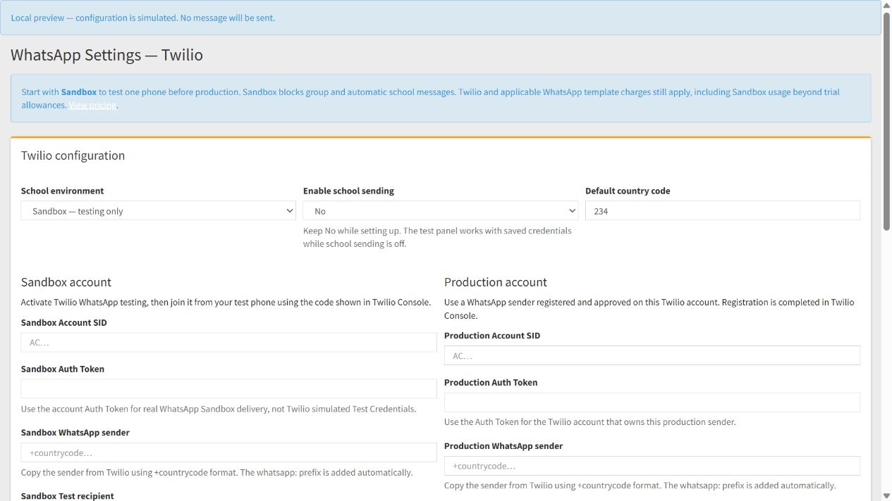
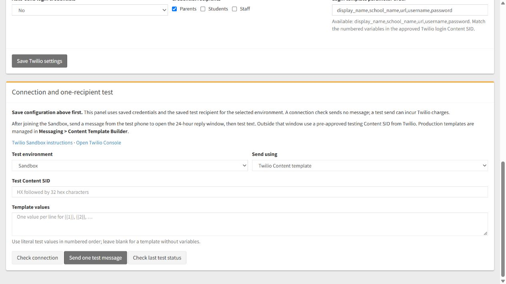

# SchoolLift WhatsApp setup with Twilio

Updated 18 October 2026. This replaces the earlier Meta and 360dialog instructions in the same file.

## Current status

The admin settings, gateway and composer now use Twilio. Direct Meta tokens, Graph API configuration, 360dialog keys and custom webhook provider setup have been removed from the active workflow.

Local implementation and simulated tests are complete. No Twilio signup, payment, live credential configuration or real WhatsApp message was performed during this change. Deploy the code, then supply the school's credentials and perform the real test below.

Twilio simplifies the integration but still charges for WhatsApp. It currently lists $0.005 per inbound/outbound message plus applicable Meta template fees. Confirm current trial allowances and rates before sending. [Twilio pricing](https://www.twilio.com/en-us/whatsapp/pricing).

## Deployment

1. Deploy the WhatsApp controllers, model, gateway and views together.
2. The first valid **Save Twilio settings** creates the separate **whatsapp_twilio_config** table in the current school's database if the database user can CREATE tables.
3. If CREATE is unavailable, run [whatsapp-twilio-config.sql](whatsapp-twilio-config.sql) in that school's database with phpMyAdmin/an authorized database account, then save again.
4. Legacy **whatsapp_config** credentials are never imported or read. The old table is retained for rollback. Numbered migration versions and the separate SMS Twilio integration are unchanged.
5. PHP cURL and outbound HTTPS to **api.twilio.com** must work. Fix server CA certificates if TLS errors appear; certificate verification remains enabled.

Existing legacy installations and new schools start with **Sandbox** and **Enable school sending: No**. Each school needs its own configuration.

## Prepare Twilio testing

1. Sign in to [Twilio Console](https://www.twilio.com/console).
2. In the legacy Console, open **Messaging > Try it out > Send a WhatsApp message** and activate Sandbox. In the new trial Console, use **Try out WhatsApp** and its testing-environment instructions.
3. Join from the receiving phone using the displayed join code/QR instructions. Copy the testing sender shown by Twilio.
4. Use the account's real **Account SID** and **Auth Token**. Simulated Test Credentials do not deliver to real phones. [Testing instructions](https://www.twilio.com/docs/whatsapp/sandbox), [simulated credentials limits](https://www.twilio.com/docs/iam/test-credentials).

The owner completes account signup, CAPTCHA, terms and billing if needed. Those actions were not performed here.

## Configure Sandbox in SchoolLift

1. Open **System Settings > WhatsApp Settings**, or the school's **admin/whatsappsettings** route.
2. Keep **School environment: Sandbox — testing only** and **Enable school sending: No**. Use country code **234** for Nigerian local contacts.
3. Complete the **Sandbox account** fields:

   | Field | Value |
   |---|---|
   | Sandbox Account SID | AC followed by 32 hex characters |
   | Sandbox Auth Token | Matching 32-character account Auth Token |
   | Sandbox WhatsApp sender | Sender copied from Twilio, in +countrycode format |
   | Sandbox Test recipient | The joined receiving phone, in +countrycode format without the local leading zero |
   | Sandbox Login credential Content SID | Leave blank; Sandbox blocks automatic credentials |

4. Click **Save Twilio settings**. Tokens are never displayed in page HTML. Blank retains a stored token only for the same Account SID and environment; changing the account needs its own token. Tokens are never copied between Sandbox and Production.
5. In **Connection and one-recipient test**, choose **Test environment: Sandbox** and click **Check connection**.
6. Success means the saved credentials authenticated and the account is active. This sends no message and does not establish sender registration, Sandbox membership or delivery. It uses Twilio's [account fetch endpoint](https://www.twilio.com/docs/iam/api/account).

## Send and verify one test message

1. From the test phone, send a message to the testing sender to open the reply window.
2. In **Connection and one-recipient test**, choose **Sandbox** and **Text reply within 24 hours**, enter a short message and click **Send one test message**.
3. The request uses only the **saved Sandbox Test recipient**. Save configuration edits first. Keep at least four seconds between tests.
4. If accepted, SchoolLift displays the current status and stores the Message SID in your admin session. Accepted, queued or sent does not confirm delivery.
5. Click **Check last test status**. **delivered/read** means Twilio reports delivery; **accepted/queued/sending/sent** remain intermediate. **failed/undelivered/canceled** show safe errors and numeric Twilio codes.
6. Confirm the message on the receiving phone. For further detail, open Twilio's **Messaging Logs** (legacy Console: **Monitor > Logs > Messaging**). SchoolLift does not automatically poll or resend.
7. For a template test, choose **Twilio Content template**, enter the **Test Content SID** starting with HX, and one text value per numbered variable per line. Use a pre-approved testing template from that account.

Sandbox membership expires and may need renewal. It is for functional testing; live tests can consume trial units or incur charges. [Sandbox requirements](https://www.twilio.com/docs/whatsapp/sandbox).

## Production

1. Complete WhatsApp sender registration in Twilio for the school's intended number. Twilio still applies business/sender approval requirements. Keeping a number in the WhatsApp Business phone app requires confirming Twilio's supported coexistence/migration route for that account; this code does not migrate numbers.
2. Prepare approved templates in **Messaging > Content Template Builder**. A Content SID chooses wording and language.
3. Fill **Production Account SID**, **Production Auth Token**, **Production WhatsApp sender** and **Production Test recipient** in SchoolLift. Save with school sending still disabled.
4. In the test panel choose **Production**, run **Check connection**, send one approved-template test, check its status and confirm phone receipt.
5. Set **School environment: Production — real school messages**, change **Enable school sending** to **Yes**, and save.
6. Open **Communicate > Send WhatsApp**. Choose **Approved WhatsApp template**, enter the approved **Twilio Content SID**, then one text value per numbered variable per line. Values can contain **{{display_name}}**, **{{student_name}}** and **{{school_name}}** for personalization. The log title stays in SchoolLift.
7. Start with a staff role containing only your test account. Students, Guardians and staff selections send to everyone in the selected group. Guardian numbers use **students.guardian_phone**, students use **students.mobileno**, staff use **staff.contact_no**.
8. **Text reply within 24 hours** still needs a recent inbound message from that recipient.

The API uses HTTPS Basic authentication, form-encoded WhatsApp From/To addresses, and either Body or ContentSid/ContentVariables. [Twilio Messages API](https://www.twilio.com/docs/messaging/api/message-resource).

Sandbox blocks ordinary group/automatic school sending. The Settings test panel can use either saved environment while school sending is disabled, without changing the school's active environment.

## Automatic notifications

Login credentials require the **Production Login credential Content SID** and matching **Login template parameter order**. Keep auto-send off until tested. Available parameter names: **display_name,school_name,url,username,password**. Select recipient groups before enabling it. Stored password hashes are suppressed.

Existing workflows sending plain text, including biometric WhatsApp alerts, still require an open reply window. This change does not convert them into approved Content templates; out-of-window alert template wiring remains separate work.

## Troubleshooting

| Result/code | Action |
|---|---|
| Missing or malformed configuration | Check SID/token format and +countrycode sender/test recipient, then save |
| 20003 / HTTP 401 or 403 | Check matching account credentials, access and account status; Sandbox uses real account credentials |
| 63007 | Activate the sender's WhatsApp channel on this same account |
| 63015 | Join the correct testing environment again from the receiving phone |
| 63016 | Closed reply window; use an approved Content template |
| 21656 | Correct numbered Content variables to match the template |
| 21658 | Shorten content/variables exceeding the allowed length |
| 63027 / 63028 / 63040 | Check the template language, variable count and approval in Twilio |
| 21608 | Review trial recipient/compliance restrictions |
| 63018 / HTTP 429 | Wait and review sender/account limits |
| Unknown provider code | Use the numeric code and Twilio Messaging Logs |
| Connection/TLS failure | Check outbound HTTPS, DNS and CA certificates; inspect Twilio logs before resending an ambiguous request |
| Save failed | Check DB write permissions and apply the supplied table SQL if CREATE is unavailable |
| No matching last test | Select the original test environment/account or send a new test after credentials change |

Provider text is not copied into the page or application error logs; safe explanations and numeric codes are used.

References: [authentication](https://www.twilio.com/docs/api/errors/20003), [membership](https://www.twilio.com/docs/api/errors/63015), [reply window](https://www.twilio.com/docs/api/errors/63016), [variables](https://www.twilio.com/docs/api/errors/21656).

## Verification

Run these commands:

- **php tests/whatsapp_admin_workflow_test.php** — includes gateway and configuration tests.
- **php tests/whatsapp_compose_workflow_test.php** — real composer validation and personalized group sends.
- **php tests/biometric_notification_workflow_test.php**.
- **php tests/shared_email_contract_test.php** — 138 assertions passed.

Coverage includes credentials, isolated environments, safe failures, DB persistence errors, admin permissions/form nonce, test throttling, delayed delivery status and partial group failures. Browser checks used the real settings/composer views with simulated configuration.

No live Twilio account or school database was contacted by these tests. Real authentication and phone delivery must be checked after deployment with the school's credentials.
