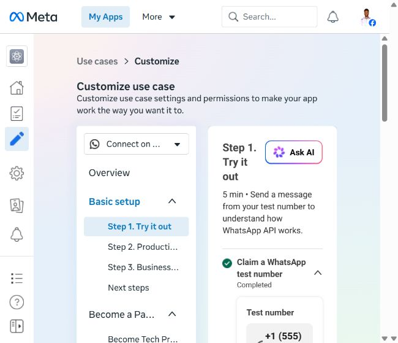
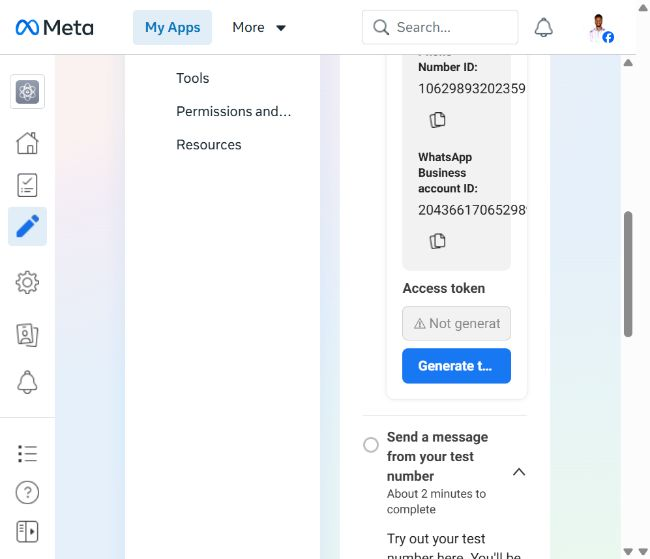
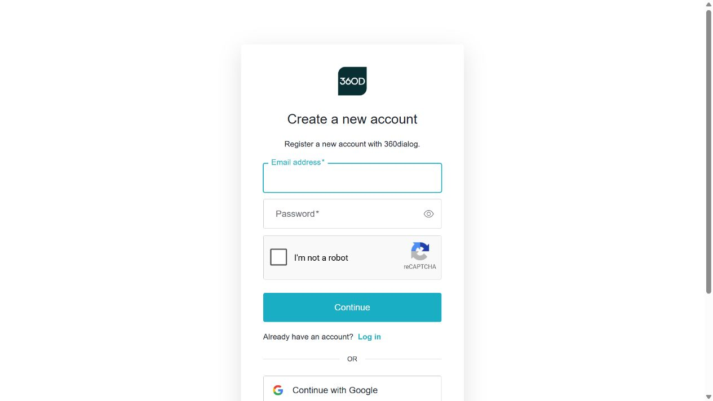
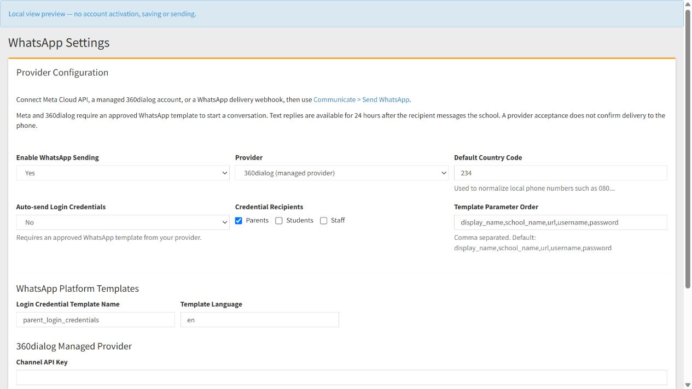
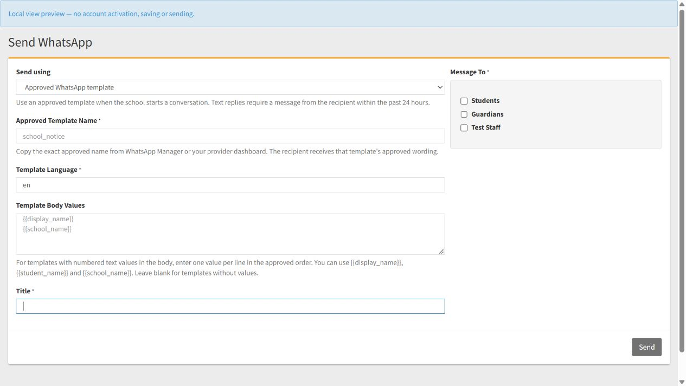

# SchoolLift Meta WhatsApp account check and navigation walkthrough

Checked on 14 October 2026 using the Meta account already signed in to the browser.

**Current production route:** managed 360dialog coexistence, keeping the existing WhatsApp Business phone app. See [Managed production setup](#managed-production-setup-with-360dialog) below. The earlier direct Meta test instructions remain a record of the initial investigation.

**Current status:** production is not activated. At your request, signup, subscriptions and payment steps were left untouched and are documented for later use. The tested SchoolLift provider support and this guide are included in this `dev` change. Merging into `main` and live deployment remain separate steps.

## What I found

| Item | Observed result |
|---|---|
| Meta app | Schoollift |
| App ID | `1420026046478761` |
| Business portfolio | Billgate Enterprises |
| App status | In development; dashboard showed Unpublished App |
| WhatsApp use case | Connect on WhatsApp |
| Claim a WhatsApp test number | Completed |
| Test sender | `+1 (555) 194-6695` |
| Test Phone Number ID | `1062989320235953` |
| Test WhatsApp Business Account ID | `2043661706529890` |
| Token field on the test page | Not generated yet |
| Test recipient selector | No recipient numbers were listed; Manage phone number list opened an Add a recipient phone number dialog |
| Hello World sample | Available; API template name `hello_world`, language `en_US`, no body parameters |
| Graph API version in the current sample | `v25.0` |
| Production phone number panel | Add new number; no registered phone number was listed in that panel |
| Production token controls | Send message section offers Generate token and describes a permanent token |
| Production webhook fields | Callback URL and Verify token were blank |
| Business verification page | Offers Start verification and describes verification as optional but recommended |

The earlier SchoolLift response, HTTP 401 / provider code 190, means Meta rejected the token used for that request. The current Meta test page does not validate the token already saved in SchoolLift. Its “Not generated yet” display alone does not establish whether an older token was previously generated or whether tokens exist elsewhere.

The recipient list and sender details above belong to this app's test setup. The production findings describe this app's production setup panel, rather than every WhatsApp account the business might own.

## Every navigation step I took

1. **Opened the signed-in Meta apps page.** The starting address was [Meta for Developers — My Apps](https://developers.facebook.com/apps/). Under **Admin Apps**, I located the **Schoollift** app. Its card showed the app ID, **Mode: In development**, and the linked **Billgate Enterprises** business portfolio.

2. **Clicked the Schoollift app name.** This opened the application's **Dashboard**. The left sidebar included **Dashboard**, **Required actions**, **Use cases**, **Testing**, **Publish**, **App settings**, and **App roles**. The dashboard showed **Unpublished App** beside the publish status.

3. **Opened the WhatsApp use case.** Under **App customization and requirements**, I clicked the arrow/link beside **Customize the Connect with customers through WhatsApp use case**. The resulting page was **Use cases > Customize**. Its use case selector displayed **Connect on WhatsApp**.

4. **Dismissed Meta's navigation tutorial.** A dialog titled **Learn how to customize use cases** appeared. I clicked **Done** to reach the setup page. The overview displayed an **Integrate with API** route and three stages: **Step 1. Try it out**, **Step 2. Production setup**, and **Step 3. Business verification**. Dismissing this tutorial was the only saved UI preference potentially changed during the inspection.

5. **Opened Basic setup > Step 1. Try it out.** In the inner navigation beside the page content, I clicked **Step 1. Try it out**. I expanded/read the **Claim a WhatsApp test number** section, which was already marked **Completed**. I checked the test sender, **Phone Number ID**, **WhatsApp Business account ID**, and **Access token** area. The token field displayed **Not generated yet** with a **Generate token** button.

6. **Checked the recipient list.** In **Send a message from your test number**, I opened the **To** selector under **Recipient**. It did not list any saved recipient numbers. I clicked **Manage phone number list**. Meta opened an **Add a recipient phone number** dialog with a country selector, phone field, and **Next** button. The dialog stated that up to five numbers can receive free test messages. I clicked **Cancel** without entering or submitting a phone number.

7. **Opened Basic setup > Step 2. Production setup.** I checked **Configure Webhooks**. The **Callback URL** and **Verify token** fields were blank. Meta also stated that this unpublished app can receive dashboard test webhooks, while production webhook data requires publication. This concerns inbound messages and delivery-status events; it is separate from the token authentication error on a send request.

8. **Expanded Register your WhatsApp phone number.** I clicked the section heading in the production setup page. It displayed **Add new number** and a link to **WhatsApp Manager**. No registered sender was listed in the panel. I did not click Add new number or start registration.

9. **Expanded Send message in production setup.** This section displayed **Step 1: Generate token**, described a permanent token, and offered **Generate token**. Its sender selector said **Select a registered number above**. The panel also contained recipient, message-body, template, and sending controls, plus a help link for manually creating a system user and token. I did not generate a token or send a message.

10. **Opened Basic setup > Step 3. Business verification.** This page described verification as **Optional but recommended** and offered **Start verification**, a business-location selector, and guidance about documents. I read the page without starting an application or uploading documents. The page was not a definitive verification-status report, so I have not inferred a verified/unverified status solely from these controls.

11. **Returned to Basic setup > Step 1. Try it out.** I opened the **Message** selector, which initially displayed **Order Confirmation**. The menu contained **Hello World**, **Plain text**, and **Order Confirmation**. I selected **Hello World** to inspect the preview. This only changed the unsent example selection.

12. **Read the generated request preview and saved the walkthrough screenshot.** The example showed `https://graph.facebook.com/v25.0/1062989320235953/messages`, template name `hello_world`, and language `en_US`. The authorization value and recipient were blank. I left the browser on this test page. No API request or message was sent.

## Your next steps to complete the first test

These are recommended actions for you to perform. They were not completed during the inspection.

1. **Return to the test setup.** Navigate **My Apps > Schoollift > Dashboard > Customize the Connect with customers through WhatsApp use case > Basic setup > Step 1. Try it out**. You can also open the [inspected test page directly](https://developers.facebook.com/apps/1420026046478761/use_cases/customize/api-testing-v2/?use_case_enum=WHATSAPP_BUSINESS_MESSAGING&product_route=whatsapp-business&selected_tab=api-testing-v2&business_id=1313732720750172).

2. **Generate the test token.** In **Claim a WhatsApp test number > Access token**, click **Generate token**. Complete the Meta account/asset selection that appears for this Schoollift app and its test account. Copy the resulting token directly into the SchoolLift settings when needed. The exact authorization dialog has not been inspected, so follow its displayed account and permission prompts rather than assuming its labels. Treat this as a test credential; use the lifetime shown by Meta rather than assuming it is suitable for permanent production use.

3. **Add your own test recipient.** Under **Send a message from your test number > Recipient > To**, open the selector and choose **Manage phone number list**. In **Add a recipient phone number**, change the country to **Nigeria +234** if using a Nigerian number, enter your own WhatsApp number in the format requested by Meta, then click **Next**. Complete the verification steps Meta displays. The dialog shown during the inspection did not proceed to verification, so the exact verification delivery method has not been confirmed.

4. **Test directly in Meta first.** Select your newly verified number in **To**, choose **Hello World** in **Message**, and click **Send message** once the button is enabled. Check your phone for the message. This establishes that Meta's sender, token and recipient work together before SchoolLift is involved. Check **Check test webhooks** for any response/status Meta displays.

5. **Enter the matching configuration in SchoolLift.** Open [Demo WhatsApp Settings](https://demo.schoollift.com.ng/admin/whatsappsettings) and sign in if necessary. Set **Enable WhatsApp Sending** to **Yes**, **Provider** to **Meta Cloud API**, **Default Country Code** to `234`, **Graph API Version** to `v25.0` as shown in this app's example, and **Phone Number ID** to `1062989320235953`. Paste the new token in **Access Token** and save. The Phone Number ID is the test sender identifier; do not use the App ID, WhatsApp Business Account ID, or sender's telephone number in this field. The login credential template settings apply to the separate credential workflow and are not needed for this Hello World composer test.

6. **Use one SchoolLift recipient.** Ensure your test staff account's contact number is the same number verified in Meta. Use a staff role containing only that test account. The composer selects groups, not individual phone numbers, so selecting Students, Guardians, or a role containing several accounts attempts to send to everyone in that group.

7. **Send from SchoolLift.** Go to **Communicate > Send WhatsApp**. Choose **Approved Meta template**; enter **Approved Template Name** `hello_world`, **Template Language** `en_US`, and leave **Template Body Values** blank. Enter a log title such as **WhatsApp test**, select only the test account's role, and click **Send**. Confirm the result shows one accepted request and confirm the message arrives on your phone. A provider acceptance alone does not prove phone delivery.

8. **Test text replies after the template arrives.** Reply from your phone to the test sender. In SchoolLift choose **Text reply within 24 hours**, type a short message and send to the same test account. The inbound reply opens the customer-service window needed for an ordinary text response.

## Moving from testing to real school messages

Navigate **Schoollift > WhatsApp use case > Basic setup > Step 2. Production setup**. The sections displayed in your account are **Configure Webhooks**, **Register your WhatsApp phone number**, **Add payment to send business-initiated messages**, and **Send message**. Production setup uses the actual business sender, its own Phone Number ID, an appropriately authorized production token, and approved templates for that WhatsApp account. Do not keep the Meta test sender's ID when switching to the real sender.

The production **Send message > Generate token** panel describes a permanent token and links to Meta's [system-user setup instructions](https://developers.facebook.com/documentation/business-messaging/whatsapp/get-started#step-5-create-a-system-user-and-generate-a-permanent-access-token). I inspected the controls but did not create a credential or change asset access.

Configure webhook reception and application publication if incoming messages or delivery-status processing is needed. The current SchoolLift compose workflow reports provider acceptance; it does not implement Meta delivery-status webhook processing. An arbitrary SchoolLift URL should not be entered as a webhook callback without implementing Meta's verification and event handling.

Business verification has its own **Step 3** page. Follow Meta's requirements for your chosen production setup; the page inspected here specifically describes it as optional but recommended. Payment, app publication, phone registration and verification were not changed or completed during this check.

## Managed production setup with 360dialog

### Selected setup and current status

| Item | Selected value or status |
|---|---|
| Sending number | `+2349076164920` — international format without the local leading zero |
| Requested public display name | SchoolLift; approval remains subject to the provider/Meta process |
| Existing account | WhatsApp Business app on the phone |
| Connection method | 360dialog coexistence, to retain the number and phone app |
| SchoolLift's own Meta onboarding | Stopped at your request; no custom onboarding flow implemented or provider application submitted |
| 360dialog account | Signup page inspected; no account created or signed in during this preparation |
| Subscription and billing | No plan purchased, payment method entered or payment confirmed |
| Phone connection | Not started; no QR code, access code or account permission approval completed |
| Production credential | No channel API key generated or entered into the live school |
| SchoolLift integration | Native 360dialog provider support prepared and tested locally; not deployed |
| Live delivery test | Not performed |

The managed provider still uses WhatsApp's official platform. Coexistence allows the Business app and API to use the same eligible number. Keep the Business app installed and follow the provider's account-activity requirements. Eligibility must be confirmed during onboarding; possession of the number alone does not guarantee activation. [360dialog coexistence documentation](https://docs.360dialog.com/docs/resources/phone-numbers/coexistence).

### Further website navigation actually performed

These steps continued the earlier inspection. They describe actions completed in the browser, rather than the future setup instructions below.

1. Returned to **My Apps > Schoollift > WhatsApp use case > Basic setup > Step 2. Production setup**. Expanded **Register your WhatsApp phone number** and clicked **Add new number**. This opened **Fill in your business information**, with business name, website/profile, country, optional address and CAPTCHA fields. Left every field empty and closed the dialog. This was later than step 8 in the initial inspection above; nothing was submitted.
2. Followed the **WhatsApp Manager** link and inspected the account selector. The account shown was the **Test WhatsApp Business Account**, owned by **Billgate Enterprises**. Its test sender showed **Connected** and **High** quality. This inspection did not establish that the production Business app number was already connected.
3. While evaluating the now-cancelled direct route, clicked **Become a Tech Provider**. Read the introductory **Onboard as a Tech Provider** dialog, then closed it without clicking **Continue** or enrolling.
4. Opened the app's **Publish** page. The privacy-policy URL appeared among its requirements and **Publish** was disabled. Opened **App settings > Basic**; privacy-policy and data-deletion instruction URLs were blank. The app secret stayed masked. No settings were saved.
5. In Meta Business Suite, opened **Settings > Business portfolio overview** for Billgate Enterprises. Inspected the visible test WhatsApp asset and access summary. No people, permissions or assets were changed.
6. Read the official 360dialog pricing, coexistence and API documentation linked in this section. On the [360dialog pricing page](https://360dialog.com/pricing), followed **Start building** to [Direct API signup](https://app.360dialog.com/signup/direct-api).
7. Inspected **Create a new account**. The page offered email/password fields, CAPTCHA, **Continue**, **Log in**, and Google/Facebook/Microsoft sign-in options. Did not enter account details, complete CAPTCHA, create an account or accept terms. After you requested that paid steps be described only, stopped account setup.

### Costs to review before proceeding — described only

On 14 October 2026, 360dialog listed the **Regular API plan at €49 per number per month**, with Meta messaging fees charged separately. Review the final checkout currency, taxes, renewal terms and messaging charges before accepting anything. This guide does not authorize a purchase. [360dialog pricing](https://360dialog.com/pricing).

For separate school installations, each interested school can arrange its own provider connection and billing. A SchoolLift Partner Platform subscription is a separate commercial choice; the prepared integration uses each school's channel API key.

**Paid steps below were not performed.** The account owner should complete them only after choosing to incur the displayed charges. Website labels beyond the inspected signup page are based on provider documentation and may change.

### Future provider setup: step-by-step

1. **Prepare the school-owned account.** Confirm the sender number, requested display name and owning Meta business portfolio. Have the phone with WhatsApp Business available. Use the school's own assets for another school; the Billgate test account and test sender above are not reusable production credentials.
2. **Create or sign in to 360dialog Hub.** Open [Direct API signup](https://app.360dialog.com/signup/direct-api). An existing customer can use **Log in**. A new customer completes account details, password, CAPTCHA and any account terms themselves. This step was deliberately skipped in this session.
3. **Paid — choose the channel plan and billing.** In **Hub > Add channel**, select the intended plan. Review and complete the displayed subscription/payment steps only when the school owner approves the actual recurring price. No checkout or authenticated billing screen was inspected here.
4. **Connect through coexistence.** Enter the number, select **Yes, Business App**, then the Facebook-account option and **Open Meta Signup**. In Meta choose **Connect a WhatsApp Business App**, select the owning portfolio and follow the phone's official Facebook Business message to approve the connection using its QR/access code. Choose whether to share history/contacts and finish the account details. If the flow instead asks to delete the existing Business app account, stop and verify the coexistence route. [360dialog onboarding navigation](https://docs.360dialog.com/docs/hub/embedded-signup/coexistence-onboarding).
5. **Obtain the connected channel's API key.** Once activation succeeds, open that number/channel in Hub and follow its Messaging API key controls. The exact authenticated button names have not been inspected. The owner should copy the key directly into SchoolLift when ready; do not put it in this guide, screenshots or Git. The integration authenticates with `D360-API-KEY` at `https://waba-v2.360dialog.io/messages`. [Official messages API reference](https://docs.360dialog.com/docs/messaging-api/api-reference/messages).
6. **Prepare an approved test template.** In the connected account's template management, create or select an approved template and note its exact API name, language and body-value order. The current SchoolLift form supports numbered text values in the body, including no-value templates. Dynamic headers, media, button values and named parameters require additional support. The old Meta test account's `hello_world` template must not be assumed to exist on this production account.

### Deploy and configure SchoolLift

The provider selection described here requires this code change to be reviewed and deployed first. Pulling `main` will expose it only after the `dev` changes have been merged into `main`. No live deployment or production database setting was changed during this preparation.

This support adds no database migration. It uses the existing per-school `whatsapp_config` table and its active-provider credential storage. An older installation that lacks that table still needs the existing WhatsApp configuration migration. Keep provider configuration in each school's database.

1. Open the school's administrator portal and navigate **System Settings > WhatsApp Settings**. For the demo, the direct address is [WhatsApp Settings](https://demo.schoollift.com.ng/admin/whatsappsettings).
2. Set the following fields after the provider has activated the number:

   | Field | Value |
   |---|---|
   | Enable WhatsApp Sending | Yes |
   | Provider | 360dialog (managed provider) |
   | Default Country Code | `234` for Nigerian local contacts |
   | Auto-send Login Credentials | No during the first delivery test |
   | Channel API Key | Key for this school's activated number |

3. Click **Save WhatsApp Settings**. For 360dialog, direct Meta **Phone Number ID**, **Access Token** and **Graph API Version** fields are hidden and are not used to send.
4. On later edits, leave **Channel API Key** blank to keep the saved key for the same provider. Switching providers requires that provider's own credential. Stored Meta tokens and 360dialog keys are not returned in the settings page HTML.
5. Leave automatic login sending disabled until its separate approved credential template is configured and tested. **Login Credential Template Name**, **Template Language** and **Template Parameter Order** apply to that workflow, rather than the composed notice below.

### Test one WhatsApp message after activation

1. Use a consenting test staff account in a role containing only that account. Save its receiving phone number under the staff contact details. Staff sends use `staff.contact_no`; Guardians use `students.guardian_phone`; Students use `students.mobileno`. Confirm the receiving phone can access WhatsApp.
2. Navigate **Communicate > Send WhatsApp**. A provider-configuration warning must be resolved before sending.
3. Choose **Approved WhatsApp template** under **Send using**. Enter the connected account's approved template name and exact language. For numbered body values, enter one value per line in approved order. Leave the values blank for a template without body values.
4. Enter a log title such as **Production WhatsApp test** and select only the test staff role. Selecting Students, Guardians or another populated role sends to that whole group.
5. Click **Send** once. A successful single-recipient result should show **Accepted by WhatsApp provider: 1**, **Failed: 0**, and **Missing phone: 0**. Confirm the message arrives on the receiving phone as well. Provider acceptance alone does not prove delivery; inspect provider delivery information if it does not arrive.
6. Reply from the receiving phone to the school's sender. Then choose **Text reply within 24 hours** in SchoolLift and test a short text response to the same role. The managed route still follows WhatsApp's template and reply-window rules. [360dialog coexistence messaging guidance](https://docs.360dialog.com/docs/resources/phone-numbers/coexistence).

### Troubleshooting and production limitations

| Result | What to check |
|---|---|
| HTTP 401 with 360dialog selected | Channel API key belongs to the activated number and is valid; a Meta access token cannot replace it |
| Insufficient messaging balance | Provider billing/balance; topping up is a paid action for the owner |
| Template name/language/parameter error | Approved template in this connected account, exact language and numbered body-value count |
| Text rejected outside the reply window | Use the approved template route to initiate the conversation |
| Missing phone | Correct contact field for the selected audience |
| Accepted but no phone delivery | Receiving number, account/template restrictions and provider delivery information |
| No 360dialog option in SchoolLift | Prepared provider code has not reached this installation |

SchoolLift currently reports provider acceptance and does not receive/store 360dialog inbound or delivery-status webhooks. Provider-managed coexistence synchronization is separate from a SchoolLift webhook receiver. Do not enter an arbitrary SchoolLift URL as a webhook callback.

Existing workflows that call ordinary text sending, including biometric notification messages, remain subject to the 24-hour reply window. Connecting 360dialog does not turn those messages into approved templates. Unattended notices outside that window need template-aware workflow changes. The composed template route and the existing login-credential template route are supported by the prepared integration.

### Local verification completed

The following checks passed without contacting a live provider:

- `php tests/whatsapp_360dialog_test.php` — also runs the gateway and compose workflow checks; covers API endpoint/header, ordered template values, text and credential sends, rejection handling and acceptance counts.
- `php tests/whatsapp_provider_config_test.php` — covers provider-specific credential selection, blank-field preservation, provider switching and persistence failures.
- `php tests/biometric_notification_workflow_test.php` and `php tests/shared_email_contract_test.php` — existing notification checks; the email check passed 138 assertions.
- PHP syntax checks for the changed WhatsApp files and new tests, plus `git diff --check` for the relevant tracked files.
- Browser checks of the actual settings and composer views with simulated configuration: 360dialog key fields, switching to direct Meta fields, approved-template composition and switching to text replies. The temporary local preview and its server were removed/stopped after inspection; no live form was saved or submitted.

These are local simulated checks, not proof that a paid channel is activated or a production message was delivered.

### Repeat for another interested school

Deploy the shared provider code to that school, then repeat the owner-controlled provider setup, billing review, coexistence connection, approved template setup and one-recipient test. Use that school's sender, owning business assets, channel key and database settings. A shared code update does not copy provider subscriptions, phone approvals, templates or credentials between schools.
